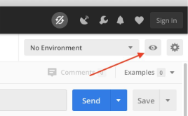
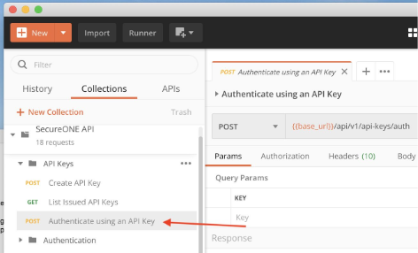
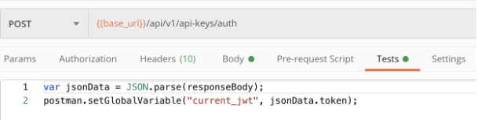
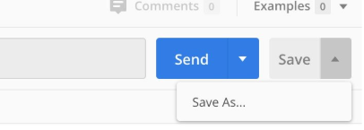

## Overview

This article describes how to configure [Postman](https://www.postman.com/downloads/) to authenticate to the Netwrix Privilege Secure for Discovery API with an API key and store the returned JSON Web Token (JWT) as a global variable.

For the available endpoints, see the [Advanced API Reference](/docs/privilegesecurediscovery/integrations/api/advanced-api-reference). To authenticate without Postman, see [Authenticate with an API key](/docs/privilegesecurediscovery/integrations/api/authenticate-with-an-api-key).

## Prerequisites

You need:
- A valid **userId**
- An API key generated for that user

## Instructions

1. Open Postman.

2. Click the eye icon in the upper-right corner.

   

3. Click **Edit** next to **Globals**.

4. Add the following variables:

   - **api_key**
     - Initial Value: `<api-key>`
     - Current Value: `<api-key>`

   - *(Optional)* **base_url**
     - Enter the URL of your environment if required.

5. Go to the API collection, expand **API Keys**, and select **Authenticate using an API key**.

   

6. Click the **Body** tab and enter the **userId** associated with the API key.

   > **NOTE:** `{{api_key}}` automatically pulls from the global variable.

7. Click the **Tests** tab.

   

   Paste the following:

   ```javascript
   var jsonData = JSON.parse(responseBody);
   postman.setGlobalVariable("current_jwt", jsonData.token);
   ```

8. Click **Save**, or use **Save As** to store it separately.

   

9. Click **Send** and verify the response appears at the bottom. You should receive a token in the response.

10. Send **GET** and **POST** requests that use the stored `current_jwt` token.

> **IMPORTANT:** The authentication token expires every 8 hours. Run the **Authenticate using an API key** request again to refresh it.
