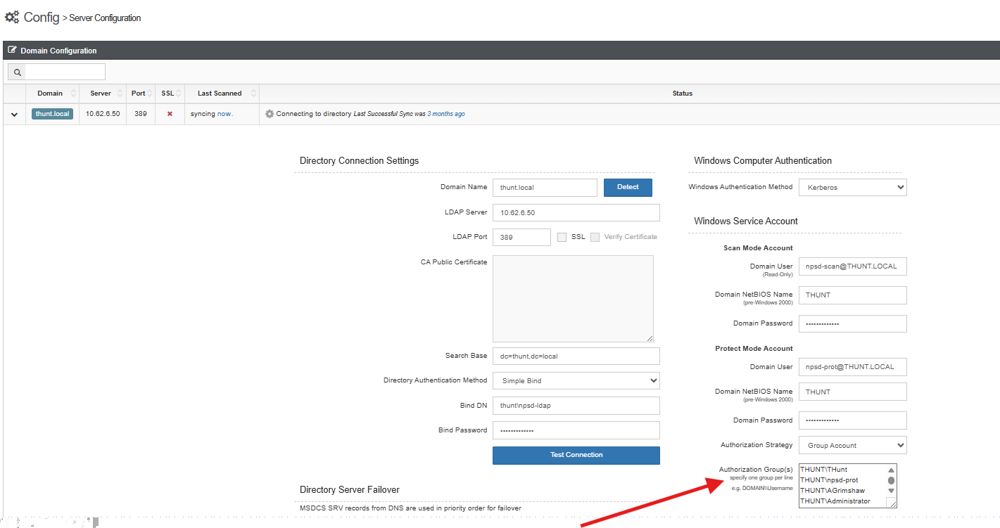

:::warning[Needs dev input: remove before publishing]
TODO: Confirm that the service_account_group_strategy release toggle and its migration still exist at 26.09.1, and whether the toggle is enabled by default on upgrade. Evidence: none.

TODO: Confirm the account type label that the UI shows for groups after the Group Account strategy is applied. The original article names it with the legacy product name. Evidence: none.

TODO: Screenshot authorization-groups-overview.png shows lab domain, IP address, account, and user names; redact or re-capture it (TODO(screenshots)). Evidence: image.

TODO: Provide a supported maximum number of authorization groups. The original article stated that the limit is unknown. Evidence: none.
:::

## Overview

The **Authorization Group(s)** feature protects service accounts by granting persistent access to the members of the groups you specify. The feature is available in the UI. It depends on a database migration named `service_account_group_strategy` (Service Account Authorization Strategy). After the migration is applied during an upgrade, a database toggle must be enabled before you can use the feature.



> **IMPORTANT:** This feature grants full access to all members of the groups you add. It is designed for service account protection scenarios only. Misuse can unintentionally grant broad access, so validate the group list before you save it.

## Instructions

### Enable the Feature

> **IMPORTANT:** This procedure changes data in the database. Back up the database before you continue.

1. Verify the migration status:

   ```bash
   s1 migrate status
   ```

2. If the `service_account_group_strategy` migration is present but the feature is not enabled, open the database shell:

   ```bash
   s1 db
   ```

3. Run the following command:

   ```javascript
   db.release_toggles.updateOne(
     { "name": "service_account_group_strategy" },
     { $set: { "enabled": true } },
     { upsert: false }
   )
   ```

### Configure the Feature

1. Log in to the UI with an Active Directory (AD) account.
2. Go to **Configure** > **Server**.
3. Expand **Domain Configuration**.
4. Set **Authorization Strategy** to `Group Account`.
5. Add the groups to the **Authorization Group(s)** field. To add several groups at once, paste a list with one group per line in the format `DOMAIN\GroupName`.
6. Scroll down and click **Save**.

## Resulting Behavior

After the systems are refreshed or rescanned:

- The groups are marked as persistent on the system.
- In the UI, the **Action** button is removed, and users and administrators cannot modify the groups.
- The account type is set to the service account type.

## Known Limitations

- The maximum number of groups that the feature supports is not defined.
- The behavior can vary depending on system refresh or rescan.
- The feature locks the configuration, which prevents further changes in the UI.
