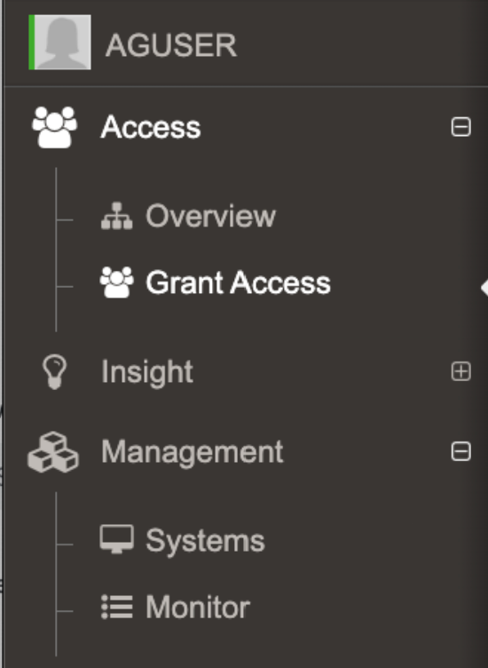
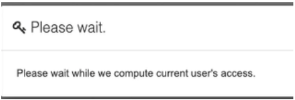

:::warning[Needs dev input: remove before publishing]
TODO: Confirm that the /api/v1/mysystems/createcache endpoint and the cache generation behavior (generated after login when the user opens Grant Access search or Management > Systems) are unchanged at 26.09.1. Evidence: none.

TODO: Screenshot ka04u00000116aS_0EM4u000008LUrh.png shows a lab user name; redact or re-capture it (TODO(screenshots)). Evidence: image.
:::

## Question

How does MySystems work, and why do users see only some systems?

## Answer

Netwrix Privilege Secure for Discovery builds a cache named **MySystems** for each user. Users with the User role can see only the systems on which they have just-in-time access (JITA) or persistent access.

### Navigation Menu

After you sign in, you have access to the following menu items:

- **Overview**
- **Grant Access**
- **Insight**
- **Systems**
- **Monitor**

> **NOTE:** **Insight** might not be available, depending on how the environment is configured. It can be an administrator-only feature.



### JITA and Persistent Access

If you have the User role, searches for computers in **Grant Access**, **Insight**, or **Systems Management**, and queries through the API, return only the systems on which you have JITA access or persistent access.

You have JITA access to a system when your Active Directory (AD) user account is in the Administrators Inventory for that system. Your account can be in the inventory in any of the following ways:

- Directly in the Administrators Inventory.
- As a member of an AD group that is in the Administrators Inventory.
- As a member of an AD group that is nested in an AD group in the Administrators Inventory.

You have persistent access to a system when any of the following is true:

- Your user account is directly in the Administrators Inventory and set to persistent.
- You are a member of an AD group in the Administrators Inventory that is set to persistent.
- You are a member of an AD group that is nested in a persistent AD group in the Administrators Inventory.

### Cache Creation

The product generates the MySystems cache after you sign in, when you use the **Grant Access** search or open **Management** > **Systems**. While the cache is being generated, a toast notification indicates that it is not yet complete.



The API endpoint that creates the MySystems cache is:

```text
/api/v1/mysystems/createcache
```
