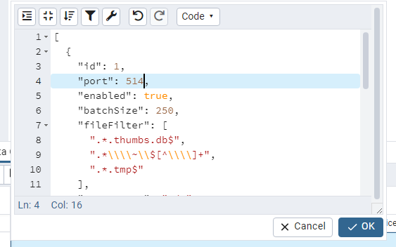

# How to Customize Event Service Listening Port(s)

## Symptom
You need to customize Threat Manager listening ports for the Event Service due to customer or environmental requirements.

## Cause
Customer or environmental requirements dictate that you change the default Netwrix Threat Manager Event Service listening port(s).

## Resolution
Alter the default Netwrix Threat Manager Event Service listening port(s) via pgAdmin:

1. Install the latest pgAdmin Console: https://www.pgadmin.org/download/
2. Contact [Netwrix Support](https://www.netwrix.com/support.html) to gain access to the Threat Manager database.
3. Select **Tables** > **defend_config table**
4. Right click and select **View/Edit Data** > **First 100 Rows**
5. Change **Value** for the port in question on line 2 (`10000` is the default File System (FS) port and `10001` is the default Active Directory (AD) port):

```json
[{"id":1,"port":10000,"enabled":true, ...}{"id":2,"port":10001,"enabled":true, ...}{...}]
```

For example, change the FS port to `514` and click **OK**:  


6. In the window below click the **Save Data Changes** icon.
7. Restart the Threat Manager Event Service.
