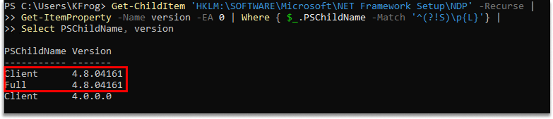

# .NET Dependencies for Netwrix Threat Manager

## Related Query

- ".NET on the Netwrix application server is End-Of-Life (EOL). Is it safe to remove it?"

## Question

Which version of .NET is required for Netwrix Threat Manager?

## Answer

The required .NET version depends on the Threat Manager version:

- Versions 3.0 and 3.1 require ASP.NET Core 8.0 and .NET Desktop Runtime 8.0, or a later 8.x release.
- Versions 3.2 and later require ASP.NET Core 10.0 and .NET Desktop Runtime 10.0, or a later 10.x release.

You can upgrade .NET components within the same major release independent of Threat Manager.

> **NOTE:** For the full requirements of each version, see:
>
> - [Netwrix Threat Manager Requirements Version 3.0](https://docs.netwrix.com/docs/threatmanager/3_0/requirements/server)
> - [Netwrix Threat Manager Requirements Version 3.1](https://docs.netwrix.com/docs/threatmanager/3_1/requirements/server)
> - [Netwrix Threat Manager Requirements Version 3.2](https://docs.netwrix.com/docs/threatmanager/3_2/requirements/server)
> - [Netwrix Threat Manager Requirements Version 3.3](https://docs.netwrix.com/docs/threatmanager/3_3/requirements/server)

.NET Framework and ASP.NET Core are separate components. Installing one does not install the other. ASP.NET Core and .NET Desktop Runtime appear in the list of installed Apps & features. .NET Framework does not appear on that list. To check which versions of .NET Framework you have installed, run the following command in PowerShell:

```powershell
Get-ChildItem 'HKLM:\SOFTWARE\Microsoft\NET Framework Setup\NDP' -Recurse | 
    Get-ItemProperty -Name version -EA 0 | Where { $_.PSChildName -Match '^(?!S)\p{L}'} | 
    Select PSChildName, version
```

Example:



## Related Links

- [Netwrix Threat Manager Requirements Version 3.0](https://docs.netwrix.com/docs/threatmanager/3_0/requirements/server)
- [Netwrix Threat Manager Requirements Version 3.1](https://docs.netwrix.com/docs/threatmanager/3_1/requirements/server)
- [Netwrix Threat Manager Requirements Version 3.2](https://docs.netwrix.com/docs/threatmanager/3_2/requirements/server)
- [Netwrix Threat Manager Requirements Version 3.3](https://docs.netwrix.com/docs/threatmanager/3_3/requirements/server)
- [.NET Dependencies for Netwrix Access Analyzer](/docs/kb/accessanalyzer/installation-and-upgrades/net_dependencies_for_netwrix_access_analyzer)
- [.NET Dependencies for Netwrix Activity Monitor](/docs/kb/activitymonitor/best-practices-and-reference/net_dependencies_for_netwrix_activity_monitor)
- [.NET Dependencies for Netwrix Threat Prevention](/docs/kb/threatprevention/configuration-and-administration/net_dependencies_for_netwrix_threat_prevention)
- [.NET Dependencies for Netwrix Recovery for Active Directory](/docs/kb/recoveryad/configuration-and-administration/net_dependencies_for_netwrix_recovery_for_active_directory)
