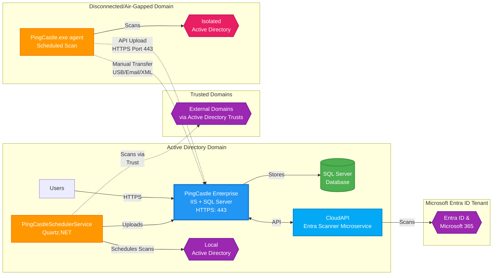

# PingCastle Enterprise architecture

PingCastle Enterprise uses a distributed architecture. `PingCastle.exe` performs Active Directory assessments and sends reports to the central Enterprise server for analysis, storage, and visualization.

## Architecture overview



## Components

### PingCastle Enterprise server

- Runs on Internet Information Services (IIS) with Windows Authentication
- Requires SQL Server database for data storage
- Accessible over HTTPS (HTTP is optional)
- Provides web interface for administrators and users

### PingCastleSchedulerService

- Runs scheduled scans of local and trusted domains and uploads the reports to the Enterprise server
- You configure schedules in **Configuration** > **Scheduler** (see [Scheduling your first scan](../configuration/first-run.md#scheduling-your-first-scan))

### CloudAPI service

- Standalone microservice that performs Entra ID scanning
- Runs as its own IIS application pool in a `CloudAPI` subfolder under the PingCastle Enterprise installation path
- Communicates with the Enterprise server via HTTPS application programming interface (API) connections and authenticates with the `CloudServiceAPIKey`
- See [Entra Scanning](../configuration/first-scan/entra-scanning.md) for architecture and setup details

### PingCastle.exe scanner and agents

- `PingCastle.exe` performs Active Directory security assessments and generates reports in XML and HTML formats
- When a security or network boundary prevents the scheduler from reaching a domain, run `PingCastle.exe` as an agent on a server that has access to that domain (see [Agent deployment](../configuration/agent-deployment.md))
- For system and network requirements, see [Requirements](../requirements/index.md)
- For command options and scanners, see the [Command reference](/docs/pingcastlecommunity/4_1/admin/command-reference) and [Scanners](/docs/pingcastlecommunity/4_1/admin/scanners)

## Report upload methods

### API upload (connected domains)

- PingCastle.exe connects directly to Enterprise server via HTTPS (port 443)
- Automated upload after scan completion
- Requires API key configuration

### Manual transfer (disconnected domains)

- Export XML reports from isolated environments
- Transfer via USB drive, email, or secure file transfer
- Import through Enterprise web interface
- Suitable for air-gapped or highly secure networks

For the ports each component uses, see [Requirements](../requirements/index.md#network-ports).

## How data flows

Reports reach the Enterprise server by one of three paths:

1. **Local and trusted domains.** The scheduler runs scans, including scans of trusted domains across Active Directory trusts, and uploads the reports to the server.
2. **Entra ID tenants.** The CloudAPI service scans the tenant and exchanges data with the server through its API.
3. **Isolated or firewalled domains.** An agent scans the domain and uploads the report over HTTPS, or you export the XML report and import it through the web interface.

The server stores the data in the SQL Server database. Users view it through the web interface over HTTPS.

For example, to cover an isolated domain, create an API key with upload permission in **Configuration** > **Agents**. Then use Windows Task Scheduler on a server that can reach that domain to run the following command weekly:

```powershell
PingCastle.exe --healthcheck --level Full --api-endpoint https://<server-name> --api-key <api-key>
```

Each run uploads the report to PingCastle Enterprise. See [Agent deployment](../configuration/agent-deployment.md) for scheduling and command options.

If you run more than one Enterprise instance across security zones, a low-trust instance can forward a filtered view of its domain data to a high-trust instance. This is separate from agent upload and applies to domains only, not Entra ID. See [Synchronization](../configuration/synchronization.md).

## Security

The application sends HTTP security headers, including a Content Security Policy (CSP) header in strict mode. It doesn't accept `unsafe-inline` or `unsafe-eval`, and it stores all JavaScript in separate files, so any JavaScript injected into a page doesn't run in the browser. You can check the headers with a third-party service such as Security Headers.

The application checks parameters twice against a model, first in the browser and then in the server application, and parameterizes all database queries. It never builds SQL strings. A filter checks each database query before PingCastle Enterprise sends it to the database. Unit tests cover this code to lower the risk of a misconfigured filter.

The application mainly uses the following frameworks:

- ASP.NET Core
- Bootstrap
- jQuery
- vis.js
- Chart.js

You can view the up-to-date list of components on the about page of the application.
