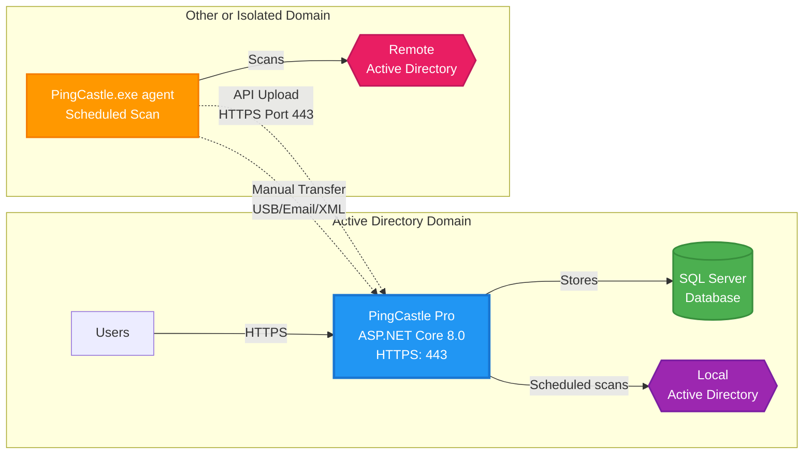

# PingCastle Pro architecture

PingCastle Pro uses a distributed architecture. `PingCastle.exe` performs Active Directory assessments and sends reports to the central PingCastle Pro server for storage and visualization.

## Architecture overview



## Components

### PingCastle Pro server

- Runs as an ASP.NET Core 8.0 application, typically behind Internet Information Services (IIS)
- Requires a database for data storage, such as SQL Server or SQL Server Express
- Signs users in with Windows Authentication or Microsoft Entra ID
- Provides a web interface for administrators and users
- Runs scheduled scans of the domain it can reach from the server. Scheduling is built into the web application. PingCastle Pro has no separate scheduler service. See [Scheduler](../configuration/scheduler.md).

### PingCastle.exe scanner and agents

- `PingCastle.exe` performs Active Directory security assessments and generates reports in XML and HTML formats. The two files hold the same data.
- By default, PingCastle filters the XML file to remove potentially private data, such as account names. To turn off this filter, run the program with the `--level Full` flag.
- When a security or network boundary prevents the server from reaching a domain, run `PingCastle.exe` as an agent on a server that has access to that domain. See [Agent deployment](../configuration/agent-deployment.md).
- For system and network requirements, see [Requirements](../requirements/index.md).
- For command options and scanners, see the [Command reference](/docs/pingcastlecommunity/4_1/admin/command-reference) and [Scanners](/docs/pingcastlecommunity/4_1/admin/scanners).

## Report upload methods

### API upload

- `PingCastle.exe` connects directly to the PingCastle Pro server over HTTPS
- Uploads the report automatically after the scan completes
- Requires an API key

### Manual transfer

- Export the XML report from an isolated environment
- Transfer it by USB drive, email, or secure file transfer
- Import it through the PingCastle Pro web interface
- Suits air-gapped or highly secure networks

You can encrypt report data to protect its confidentiality. See [Report encryption](/docs/pingcastlecommunity/4_1/configuration/report-encryption).

## How data flows

Reports reach the PingCastle Pro server by one of two paths:

1. **Domains the server can reach.** The server runs scheduled scans itself.
2. **Isolated or firewalled domains.** An agent scans the domain and uploads the report over HTTPS, or you export the XML report and import it through the web interface.

The server stores the data in the database. Users view it through the web interface over HTTPS.

For example, to cover an isolated domain, create an API key with upload permission in **Configuration** > **Agents**. Then use Windows Task Scheduler on a server that can reach that domain to run the following command weekly:

```powershell
PingCastle.exe --healthcheck --level Full --api-endpoint https://<server-name> --api-key <api-key>
```

Each run uploads the report to PingCastle Pro. See [Agent deployment](../configuration/agent-deployment.md) for scheduling and command options.

## Security

The application sends HTTP security headers, including a Content Security Policy (CSP) header in strict mode. It doesn't accept `unsafe-inline` or `unsafe-eval`, and it stores all JavaScript in separate files, so any JavaScript injected into a page doesn't run in the browser. You can check the headers with a third-party service such as Security Headers.

The application checks parameters twice against a model, first in the browser and then in the server application, and parameterizes all database queries. It never builds SQL strings. A filter checks each database query before PingCastle Pro sends it to the database. Unit tests cover this code to lower the risk of a misconfigured filter.

The application mainly uses the following frameworks:

- ASP.NET Core
- Bootstrap
- jQuery
- vis.js
- Chart.js
